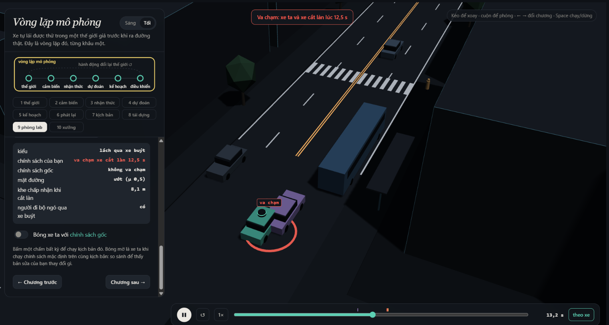
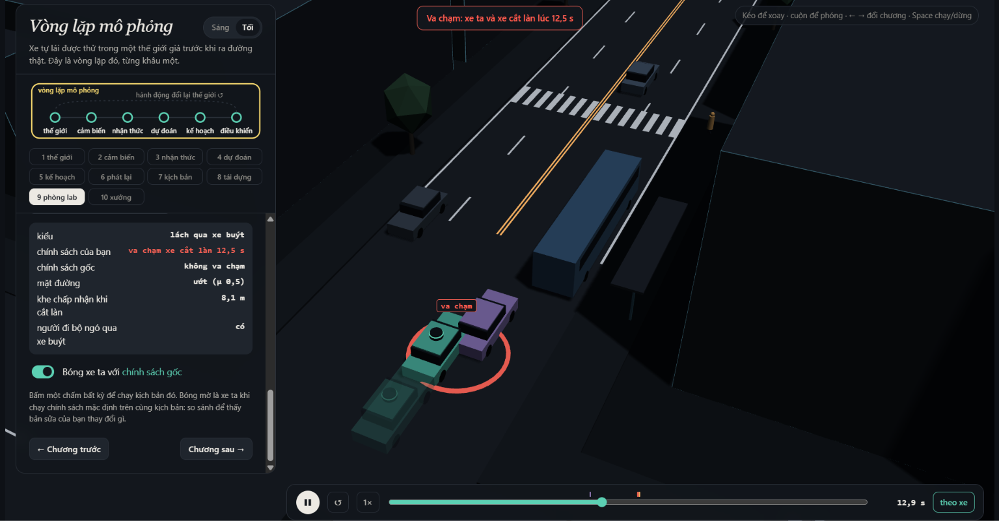
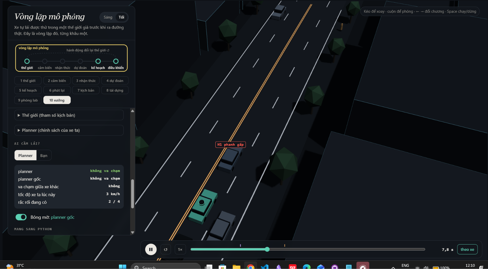

MSSV: 202602673

# Lab 11 · Scenario Forge — báo cáo

Mỗi câu: trả lời ngắn, **trích số từ `evidence/`** (ghi tên file và trường, ví dụ `mc.json: crashes = 4`). Grader chạy lại với MSSV của bạn; số không khớp `evidence/` thì mất điểm phần D (RUBRIC), và câu dựa trên số sai khó được điểm đầy đủ. Không cần văn hay: một bảng nhỏ và hai, ba câu giải thích là đủ.

Thị trấn của bạn (`meta.json: _run.town`): A (`meta.json: _run.town = A`)

## 1. Phát lại log có trung thực không? (bước A)

Trong `replay.json`: bao nhiêu kịch bản bị bỏ vì người lái gây va chạm, bao nhiêu va chạm khi planner chạy trên log phát lại, bao nhiêu trong thế giới phản ứng, theo từng loại tiếp xúc. Giải thích vì sao phần lớn va chạm của "phát lại" là `rear`, và vì sao đó là va chạm **giả**. Chọn một kịch bản trong `replay_only` và nói chuyện gì đã xảy ra.

Số log bị bỏ: `replay.json: dropped_human_crash_logs = 0`. Tổng va chạm: `replay.json: replay.crashes = 103` khi phát lại và `replay.json: reactive.crashes = 2` trong thế giới phản ứng.

| Tiếp xúc | Phát lại | Phản ứng |
|---|---|---|
| rear | `replay.json: replay.contact.rear = 93` | Không có khóa rear |
| side | `replay.json: replay.contact.side = 10` | `replay.json: reactive.contact.side = 1` |
| front | Không có khóa front | `replay.json: reactive.contact.front = 1` |

Khóa vắng mặt nghĩa là không ghi nhận loại tiếp xúc đó. Phần lớn là rear: planner phanh sớm hơn người lái trong log nhưng xe bám sau TG vẫn chạy theo quỹ đạo đã ghi, không phanh theo planner. Va chạm này là giả do mất phản hồi tương tác.

Ví dụ `replay.json: replay_only[1].scenario = 3`, `replay.json: replay_only[1].contact = rear`: TG chạy theo log đâm đuôi planner khi planner giảm tốc sớm; trong thế giới phản ứng TG có thể giảm tốc và không va chạm. `replay.json: replay_only[1].min_ttc_reactive = 7.460629498692649` giây. Đây là diễn giải cơ chế; JSON tổng kết không ghi thời điểm phanh cụ thể.

## 2. Kịch bản bất khả thi (bước B)

Liệt kê các luật trong `is_feasible` và căn cứ vật lý của từng luật (ma sát, gia tốc, tốc độ người). Trong `hunt.json`, cuộc săn nào sinh nhiều kịch bản bất khả thi nhất, và vì sao CEM lại bị kéo về phía đó? Điều gì xảy ra với ước lượng nếu bạn **đếm** chúng là va chạm?

Các ngưỡng sau là hằng số của is_feasible theo đề bài, không phải số đo evidence:

- Đổi làn cosine rộng 3.5 m cần gia tốc ngang a_lat = (π/cutDur)² × 3.5/2 ≤ μg, để không vượt độ bám ngang của lốp.
- Phanh sau nhập làn cutBrake ≤ μg, do ma sát lốp giới hạn gia tốc hãm.
- Người đi bộ pedV ≤ 2.5 m/s; vượt ngưỡng là chạy, ngoài giả định đi bộ.
- Xe cắt vào có cutV trong (0, 22] m/s, bảo đảm xe tiến và thuộc miền tốc độ cho phép.

Nhiều mẫu bất khả thi nhất là `hunt.json: crosswalk_block.infeasible = 12`; so với `hunt.json: rear_ended.infeasible = 5`, `hunt.json: cut_in.infeasible = 2`, `hunt.json: bus_bypass.infeasible = 0`. CEM ưu tiên mẫu nguy hiểm nên dễ bị kéo về chuyển động vượt độ bám hoặc ngoài miền vật lý. Đếm chúng là va chạm sẽ thổi phồng xác suất bằng tai nạn không thể xảy ra theo giả định mô hình.

## 3. Monte Carlo cho bạn biết gì (bước C1)

`mc.json`: k, n, p̂ và khoảng Wilson 95 %. Với p̂ đó, cần bao nhiêu lần chạy để khoảng tin cậy hẹp lại còn ±20 % của p? Có kiểu thất bại nào **chưa hề xuất hiện** trong 3 000 lần chạy không? Con số đúng cần báo cho kiểu đó là gì?

Số va chạm k: `mc.json: crashes = 3`; số lượt `mc.json: n = 3000`; p̂: `mc.json: p = 0.001`. Khoảng Wilson 95 %: từ `mc.json: lo = 0.0003401410630165598` đến `mc.json: hi = 0.002936196810458527`.

Với mục tiêu nửa độ rộng tương đối ±20 %, n ≈ 1.96²(1−p)/(0.2²p) ≈ 96/p. Thay `mc.json: p = 0.001`, suy ra khoảng 96 000 lượt; dùng biểu thức chưa làm tròn được 95 943.96 lượt, làm tròn lên 95 944. Đây là phép tính từ evidence, không phải ngân sách đã chạy.
| Kiểu chưa thấy | Số lần | Cận trên Wilson cần báo |
|---|---|---|
| cut_in | `mc.json: per_mode.cut_in.k = 0` | `mc.json: per_mode.cut_in.hi = 0.0012788956648046956` |
| crosswalk_block | `mc.json: per_mode.crosswalk_block.k = 0` | `mc.json: per_mode.crosswalk_block.hi = 0.0012788956648046956` |
| rear_ended | `mc.json: per_mode.rear_ended.k = 0` | `mc.json: per_mode.rear_ended.hi = 0.0012788956648046956` |
| other | `mc.json: per_mode.other.k = 0` | `mc.json: per_mode.other.hi = 0.0012788956648046956` |

Không quan sát thấy không có nghĩa là xác suất bằng không; phải báo cận trên cho từng kiểu.

## 4. Importance sampling, ESS và độ suy biến (bước C3)

Bảng: với từng kiểu và từng seed trong `estimate.json`, ghi `p`, `hits`, `ess`, `top_share`. Ba seed có đồng ý với nhau không, và có đồng ý với Monte Carlo không? Ở đâu `top_share` lớn (> 0,5), và vì sao khi đó con số thực ra chỉ là trọng số của một mẫu? So ngân sách (`budget`) với số lần chạy Monte Carlo cần để có cùng độ chính xác. Phần `other` trong tổng lấy từ đâu, và vì sao không săn nó?

Mỗi ô trích trực tiếp file và đường dẫn trường để đối chiếu.

| Mode | Seed | p trong JSON | hits | ess | top_share |
|---|---|---|---|---|---|
| bus_bypass | `estimate.json: seeds[0].seed = 0` | `estimate.json: seeds[0].per.bus_bypass.p = 0.0006869319093288169` | `estimate.json: seeds[0].per.bus_bypass.hits = 37` | `estimate.json: seeds[0].per.bus_bypass.ess = 127.76654972827936` | `estimate.json: seeds[0].per.bus_bypass.top_share = 0.1887295589654736` |
| cut_in | `estimate.json: seeds[0].seed = 0` | `estimate.json: seeds[0].per.cut_in.p = 0.0` | `estimate.json: seeds[0].per.cut_in.hits = 0` | `estimate.json: seeds[0].per.cut_in.ess = 128.7817950887538` | `estimate.json: seeds[0].per.cut_in.top_share = 0.0` |
| crosswalk_block | `estimate.json: seeds[0].seed = 0` | `estimate.json: seeds[0].per.crosswalk_block.p = 1.653099068390009e-06` | `estimate.json: seeds[0].per.crosswalk_block.hits = 93` | `estimate.json: seeds[0].per.crosswalk_block.ess = 116.98226539207195` | `estimate.json: seeds[0].per.crosswalk_block.top_share = 0.22465869139326042` |
| rear_ended | `estimate.json: seeds[0].seed = 0` | `estimate.json: seeds[0].per.rear_ended.p = 0.0` | `estimate.json: seeds[0].per.rear_ended.hits = 0` | `estimate.json: seeds[0].per.rear_ended.ess = 118.9158800319421` | `estimate.json: seeds[0].per.rear_ended.top_share = 0.0` |
| bus_bypass | `estimate.json: seeds[1].seed = 1` | `estimate.json: seeds[1].per.bus_bypass.p = 0.000421344802583463` | `estimate.json: seeds[1].per.bus_bypass.hits = 26` | `estimate.json: seeds[1].per.bus_bypass.ess = 127.08784732092106` | `estimate.json: seeds[1].per.bus_bypass.top_share = 0.30876724792195026` |
| cut_in | `estimate.json: seeds[1].seed = 1` | `estimate.json: seeds[1].per.cut_in.p = 0.0` | `estimate.json: seeds[1].per.cut_in.hits = 0` | `estimate.json: seeds[1].per.cut_in.ess = 131.5575154106157` | `estimate.json: seeds[1].per.cut_in.top_share = 0.0` |
| crosswalk_block | `estimate.json: seeds[1].seed = 1` | `estimate.json: seeds[1].per.crosswalk_block.p = 2.483743758241341e-05` | `estimate.json: seeds[1].per.crosswalk_block.hits = 80` | `estimate.json: seeds[1].per.crosswalk_block.ess = 123.1733035299762` | `estimate.json: seeds[1].per.crosswalk_block.top_share = 0.9315809461819868` |
| rear_ended | `estimate.json: seeds[1].seed = 1` | `estimate.json: seeds[1].per.rear_ended.p = 0.0` | `estimate.json: seeds[1].per.rear_ended.hits = 0` | `estimate.json: seeds[1].per.rear_ended.ess = 123.56470108185567` | `estimate.json: seeds[1].per.rear_ended.top_share = 0.0` |
| bus_bypass | `estimate.json: seeds[2].seed = 2` | `estimate.json: seeds[2].per.bus_bypass.p = 0.0005377381726433769` | `estimate.json: seeds[2].per.bus_bypass.hits = 36` | `estimate.json: seeds[2].per.bus_bypass.ess = 120.86673845634054` | `estimate.json: seeds[2].per.bus_bypass.top_share = 0.4261024176411109` |
| cut_in | `estimate.json: seeds[2].seed = 2` | `estimate.json: seeds[2].per.cut_in.p = 0.0` | `estimate.json: seeds[2].per.cut_in.hits = 0` | `estimate.json: seeds[2].per.cut_in.ess = 126.33117294892448` | `estimate.json: seeds[2].per.cut_in.top_share = 0.0` |
| crosswalk_block | `estimate.json: seeds[2].seed = 2` | `estimate.json: seeds[2].per.crosswalk_block.p = 5.208421696825843e-07` | `estimate.json: seeds[2].per.crosswalk_block.hits = 89` | `estimate.json: seeds[2].per.crosswalk_block.ess = 124.15610594958535` | `estimate.json: seeds[2].per.crosswalk_block.top_share = 0.39492614958320127` |
| rear_ended | `estimate.json: seeds[2].seed = 2` | `estimate.json: seeds[2].per.rear_ended.p = 0.0` | `estimate.json: seeds[2].per.rear_ended.hits = 0` | `estimate.json: seeds[2].per.rear_ended.ess = 134.01743664657906` | `estimate.json: seeds[2].per.rear_ended.top_share = 0.0` |

Các seed bus_bypass tương đối nhất quán: khoảng lo–hi giao nhau và các điểm IS nằm trong Wilson MC đã dẫn. Tuy nhiên, khoảng riêng của seed giữa không chứa điểm MC (`mc.json: p = 0.001`); không nên đòi các điểm ước lượng trùng nhau. Với crosswalk_block, khoảng của seed đầu và cuối không giao nhau: độ ổn định kém, dù các điểm đều dưới cận trên MC cho kiểu này.

Trường vượt ngưỡng chẩn đoán top_share > 0.5 là `estimate.json: seeds[1].per.crosswalk_block.top_share = 0.9315809461819868`. Tổng trọng số va chạm gần như do một mẫu quyết định; nhiều hits không bảo đảm độ chính xác. ESS đo phân tán trọng số toàn bộ mẫu, không thay thế chẩn đoán trọng số trên mẫu va chạm.

Các ô p bằng không của cut_in và rear_ended chỉ ghi nhận không có hits, không chứng minh xác suất thật bằng không. Phải dùng cận `estimate.json: seeds[0].per.cut_in.upper_zero_hits = 0.025`, `estimate.json: seeds[1].per.cut_in.upper_zero_hits = 0.025`, `estimate.json: seeds[2].per.cut_in.upper_zero_hits = 0.025`, `estimate.json: seeds[0].per.rear_ended.upper_zero_hits = 0.025`, `estimate.json: seeds[1].per.rear_ended.upper_zero_hits = 0.025`, `estimate.json: seeds[2].per.rear_ended.upper_zero_hits = 0.025`, thay vì các trường hi bằng không.

`estimate.json: budget = 16800` nhỏ hơn khoảng 96 000 lượt MC suy ra từ `mc.json: p = 0.001` theo công thức ở câu trước. Tuy nhiên, biến động seed và top_share chưa chứng minh IS đạt cùng mục tiêu ±20 %; không thể chỉ so ngân sách rồi khẳng định cùng độ chính xác.

Phần other lấy từ `estimate.json: other.source = mc.json`; đây là nhóm dư gồm nhiều cơ chế nên không có một cơ chế đơn nhất để proposal nhắm tới. Dù `estimate.json: other.k = 0` trên `estimate.json: other.n = 3000`, phải báo cận `estimate.json: other.hi = 0.0012788956648046956`, không coi xác suất bằng không. Khi diễn giải tổng cần giữ bất định của other và các cận upper_zero_hits của cơ chế chưa thấy.

## 5. Các kiểu thất bại (bước C2 + 3D)

Kết quả từng cuộc săn:

- `hunt.json: bus_bypass.found.bus_bypass = 150`.
- `hunt.json: cut_in.found.bus_bypass = 15`.
- `hunt.json: crosswalk_block.found.crosswalk_block = 63`; `hunt.json: crosswalk_block.found.bus_bypass = 3`.
- `hunt.json: rear_ended.found.bus_bypass = 5`; `hunt.json: rear_ended.found.crosswalk_block = 4`.

Bus_bypass: C2 chờ khe rồi lách qua xe buýt dừng, xe buýt che tầm nhìn ego nên ego nhận ra xe chen vào quá muộn. Crosswalk_block: người đi bộ bước ra từ sau xe buýt; ego dừng nhưng thân xe còn chắn vạch qua đường.

Ảnh B-01 (`viewer.json: runs[0].id = B-01`), đường ướt μ 0,5, khe chấp nhận 8,1 m: C2 (xe tím) lách xe buýt rồi nhập vào làn, xe ta (xe đặc, policy gốc) chạm C2 lúc 12,5 s (banner đỏ của trình xem). Ảnh có bóng mờ của bản sửa ở câu 6.

> Ảnh: không kèm ảnh chụp trình xem cho kiểu này. Có thể xem lại run C-01 (`viewer.json: runs[4].id = C-01`); phát lại bằng Python cho sự kiện block với P1 lúc t = 21,5 s (số từ lần phát lại).

Không tìm thấy cut_in hoặc rear_ended trong found. Độ tin cậy về việc chúng không tồn tại là thấp: săn định hướng không phải mẫu tự nhiên độc lập. Cần báo cận MC `mc.json: per_mode.cut_in.hi = 0.0012788956648046956` và `mc.json: per_mode.rear_ended.hi = 0.0012788956648046956`, không báo xác suất bằng không. Cần săn riêng mỗi mode vì mục tiêu chung dễ dồn proposal vào bus_bypass dễ nhất; ngay cuộc săn cut_in cũng chỉ tìm bus_bypass, còn cuộc săn rear_ended tìm các mode khác như trên.

## 6. Sửa planner (bước E + 3D)

Policy chọn trên TRAIN: `fix.json: chosen.policy.cutinLat = 3.0`; các núm còn lại giữ mặc định. Khoảng nhận xe nhập làn theo phương ngang lớn hơn giúp ego phản ứng sớm hơn.

| Tập / policy | fail | fail_hi_seen | fail_hi |
|---|---|---|---|
| TRAIN baseline | `fix.json: baseline_train.fail = 0.0004350093951191235` | `fix.json: baseline_train.fail_hi_seen = 0.0008229370383387267` | `fix.json: baseline_train.fail_hi = 0.0008229370383387267` |
| TRAIN chọn | `fix.json: chosen.fail = 1.0787595918613592e-06` | `fix.json: chosen.fail_hi_seen = 2.491340155950194e-06` | `fix.json: chosen.fail_hi = 2.491340155950194e-06` |
| TEST baseline | `fix.json: baseline_test.fail = 0.00040657374121348173` | `fix.json: baseline_test.fail_hi_seen = 0.000987094719355615` | `fix.json: baseline_test.fail_hi = 0.0022659903841603106` |
| TEST chọn | `fix.json: chosen_test.fail = 7.5319376169206e-07` | `fix.json: chosen_test.fail_hi_seen = 1.5758709251520082e-06` | `fix.json: chosen_test.fail_hi = 0.038780471535729846` |

| Tập / policy | Quãng đường trung bình (m) | Số khung phanh gấp trung bình |
|---|---|---|
| TRAIN baseline | `fix.json: baseline_train.progress = 213.0473382472992` | `fix.json: baseline_train.harsh = 9.69140625` |
| TRAIN chọn | `fix.json: chosen.progress = 213.2034930586815` | `fix.json: chosen.harsh = 8.046875` |
| TEST baseline | `fix.json: baseline_test.progress = 215.72192016601562` | `fix.json: baseline_test.harsh = 8.201333333333332` |
| TEST chọn | `fix.json: chosen_test.progress = 215.59594959513348` | `fix.json: chosen_test.harsh = 7.717666666666666` |

TEST cho điểm ước lượng và cận của các mode đã thấy giảm, nhưng chưa chứng minh rủi ro tổng thể thật sự thấp hơn. Dù bản sửa tốt hơn thật, cận trên vẫn có thể lớn hơn điểm baseline: đó là hai đại lượng khác nhau, và mode chưa thấy phải cộng bất định. Cụ thể `fix.json: chosen_test.bus_bypass.upper_zero_hits = 0.0375` và `fix.json: chosen_test.other_crashes.hi = 0.0012788956648046956`. Không có hits không có nghĩa xác suất bằng không. TRAIN fail_hi trong file chỉ phản ánh phần đã thấy, chưa cộng các cận này.

Vì B-01 được cuộc săn tìm ra dưới policy gốc, trình xem chạy xe đặc bằng policy gốc và vẽ **bóng mờ là policy chọn** (`cutinLat = 3.0`); nhãn bảng thông tin vì vậy bị đảo ("chính sách của bạn" = gốc, va chạm 12,5 s; "chính sách gốc" = bản sửa, không va chạm). Trong ảnh, xe đặc chạm C2 còn bóng mờ dừng phía sau, không tiếp xúc. Phát lại bằng Python ngoài `evidence/` cho cùng kết quả trên B-01…B-04 (gốc chạm C2 lúc 12,5–12,7 s, bản sửa không có sự kiện ego); trên C-01…C-04 cả hai policy đều chặn vạch như nhau.

Núm nghe an toàn hơn nhưng tăng điểm thất bại: `fix.json: table[8].policy.T = 2.0`, `fix.json: table[8].fail = 0.000917426558228401`, so với `fix.json: baseline_train.policy.T = 1.6` và fail baseline TRAIN ở bảng. Khe lớn tạo cơ hội để C2 chen vào; giảm tốc cũng có thể khiến TG bám sát đâm đuôi. Đây là cơ chế phản ứng giải thích tính không đơn điệu, không phải bằng chứng rằng dòng này đã quan sát rear_ended. Tương tự `fix.json: table[2].policy.cautionV = 6.0` có `fix.json: table[2].fail = 0.0009637356174758274`: giảm tốc thận trọng không bảo đảm giảm lỗi.

## 7. Từ mô phỏng ra đường thật

Các giả định đọc từ avsim/space.py và town A (`meta.json: _run.town = A`), không phải số đo evidence. Hướng lệch dưới đây là dự đoán cơ chế cần kiểm định trong thế giới phản ứng.

| Giả định | Dữ liệu thực thay thế | Hướng sai nếu giả định sai |
|---|---|---|
| cutGap là lognormal với trung vị theo town | Trích khe nhập làn từ [NGSIM của FHWA](https://ops.fhwa.dot.gov/trafficanalysistools/ngsim.htm), sau đó hiệu chỉnh bằng video tại trạm buýt địa phương | Nếu khe thực nhỏ hơn giả định, có thể đánh giá thiếu nhập làn sát và bus_bypass; khe lớn hơn có thể làm ngược lại. |
| pedLook là Bernoulli, người đi bộ có thể ngó qua xe buýt | Mã hóa hành vi nhìn và bước từ video tại trạm theo phương pháp trong [nghiên cứu quan sát trạm buýt Utah](https://arxiv.org/abs/2408.08890); đây là nguồn phương pháp, không phải phép đo trực tiếp pedLook địa phương | Nếu thực tế ít người ngó hơn, có thể đánh giá thiếu crosswalk_block; nhiều người ngó hơn thì có thể đánh giá thừa. |
| wet là Bernoulli và mu chỉ có trạng thái khô/ướt cố định | Ghép mưa tại trạm gần đường từ [NOAA NCEI Daily Summaries](https://www.ncei.noaa.gov/access/search/datasets/daily-summaries/) với nhật ký mặt đường và phép đo ma sát của đơn vị quản lý đường | Nếu thời gian ướt cao hơn hoặc độ bám thấp hơn giả định, quãng phanh dài hơn nên nguy cơ thường bị đánh giá thiếu; chiều ngược lại thường đánh giá thừa. Mưa không đồng nghĩa đường luôn ướt. |

## 8. Giới hạn

- Chỉ một tuyến phố với trạm buýt cố định: xác suất không đại diện mạng đường. Có thêm một tuần, đo khe nhập làn, lưu lượng và xung đột tại các trạm có hình học khác, rồi tái ước lượng theo phơi nhiễm từng nơi.
- Tài xế phản ứng chủ yếu bằng IDM: chưa mô tả đủ mất tập trung, do dự, nhường đường. Đo phân phối thời gian phản ứng và giảm tốc xe bám sau từ video, kiểm tra độ nhạy khi đổi mô hình hành vi.
- Cảm biến hoàn hảo ngoài che khuất xe buýt: chưa tính bỏ sót, trễ và nhiễu. Đo độ trễ phát hiện người đi bộ/C2 khi ló ra, đưa sai số vào mô phỏng và so thay đổi rủi ro cùng quãng đường tiến được.

## 9. Rắc rối của bạn (bước G + chương 10)

Hazard là xe dẫn L1 phanh gấp, giống xe trước giảm tốc bất ngờ vì ùn tắc hoặc vật cản. Cấu hình: `hazard.json: hazards[0].who = L1`, `hazard.json: hazards[0].decel = 4.5` m/s², `hazard.json: hazards[0].dur = 2.5` s, `hazard.json: hazards[0].t0 = 4.0` s, `hazard.json: hazards[0].trig = 40.0` m. Planner phản ứng theo khe/tốc độ nên có thể chậm với giảm tốc đột ngột; phanh mạnh lại gây khó cho TG.

Nguồn giả định, trích `hazard.json: why`: “Dur, trig, t0 là lựa chọn kỹ thuật có tham chiếu, không phải khoảng phân vị thực nghiệm; lấy mẫu đều chỉ để khảo sát độ nhạy.” why dẫn NHTSA DOT HS 810 846 về phanh và FHWA-HRT-04-091 về quãng dừng; đây là tham chiếu thiết kế, không phải phân phối đã hiệu chỉnh cho Việt Nam. `hazard.json: space.h0_decel = [3.0, 4.9]`, `hazard.json: space.h0_dur = [1.0, 4.0]`, `hazard.json: space.h0_t0 = [2.0, 18.0]`, `hazard.json: space.h0_trig = [20.0, 60.0]`.

`hazard.json: exposure = 0.08`; trích `hazard.json: why`: “hai giả định này không phải thống kê của nghiên cứu hay số đo Việt Nam.” Exposure ngoại suy theo độ dài chuyến và hệ số gặp xe dẫn, còn bất định khi chuyển phanh đỉnh sang xung phanh hằng; chưa phải tần suất thực địa đã xác nhận.

`mine.json: accepted = 0.9946666666666667`; `mine.json: infeasible = 8`.

| Đại lượng | baseline | chosen |
|---|---|---|
| n | `mine.json: baseline.n = 1492` | `mine.json: chosen.n = 1492` |
| crashes | `mine.json: baseline.crashes = 1` | `mine.json: chosen.crashes = 0` |
| avoidable | `mine.json: baseline.avoidable = 0` | `mine.json: chosen.avoidable = 0` |
| unavoidable | `mine.json: baseline.unavoidable = 0` | `mine.json: chosen.unavoidable = 0` |
| unattributed | `mine.json: baseline.unattributed = 1` | `mine.json: chosen.unattributed = 0` |
| low_speed | `mine.json: baseline.low_speed = 1` | `mine.json: chosen.low_speed = 0` |
| avoidable_foreknown | `mine.json: baseline.avoidable_foreknown = 0` | `mine.json: chosen.avoidable_foreknown = 0` |
| p | `mine.json: baseline.p = 0.0` | `mine.json: chosen.p = 0.0` |
| Wilson lo | `mine.json: baseline.lo = 0.0` | `mine.json: chosen.lo = 0.0` |
| Wilson hi | `mine.json: baseline.hi = 0.002568186364117698` | `mine.json: chosen.hi = 0.002568186364117698` |
| per_trip | `mine.json: baseline.per_trip = 0.0` | `mine.json: chosen.per_trip = 0.0` |
| per_trip_hi | `mine.json: baseline.per_trip_hi = 0.00020545490912941583` | `mine.json: chosen.per_trip_hi = 0.00020545490912941583` |

Wilson lo/hi là khoảng cho xác suất lỗi planner có điều kiện trên hazard và traffic town. p và per_trip là điểm ước lượng khi chưa quan sát lỗi tránh được; phải báo hi và per_trip_hi cho rủi ro, không kết luận xác suất thật bằng không. per_trip = p × exposure; per_trip_hi = hi × exposure.

Avoidable: phanh hết mức ngay khi hazard đang hoạt động và vừa nhìn thấy thì tránh được. Unavoidable: ngay oracle đó cũng không tránh được. Unattributed: chưa có hazard hoạt động trước tiếp xúc, không quy lỗi cho hazard. low_speed là cờ nằm trong các lớp, không cộng như lớp riêng. avoidable_foreknown giả định biết từ lúc hazard bắt đầu kể cả khi bị che.

Chuẩn “tránh được” lạc quan về tri giác và điều khiển: oracle biết ngay lúc nhìn thấy và phanh toàn bộ μg, nên có thể đếm nhiều lỗi tránh được hơn planner thật làm nổi. Ngược lại oracle chỉ phanh, không đánh lái, nên có thể đếm ít hơn khả năng tránh của người lái được phép chuyển hướng.

Va chạm baseline duy nhất là `mine.json: baseline.examples[0].kind = unattributed`, `mine.json: baseline.examples[0].other = C2`, `mine.json: baseline.examples[0].t = 14.7` s, `mine.json: baseline.examples[0].v_ego = 0.7347483038902283` m/s; `mine.json: baseline.examples[0].fire_t = null`. Chưa có bằng chứng L1 gây lỗi tránh được; cảnh chính xác cũng không có va chạm (`mine.json: exact.planner = []`).

So mỗi chuyến với một cơ hội gặp bus_bypass: `estimate.json: seeds[0].per.bus_bypass.p = 0.0006869319093288169`, `estimate.json: seeds[1].per.bus_bypass.p = 0.000421344802583463`, `estimate.json: seeds[2].per.bus_bypass.p = 0.0005377381726433769`; nhân từng p với một cơ hội/chuyến cho đúng các điểm tần suất đó. Cận per_trip_hi của hazard trong bảng nhỏ hơn các điểm bus_bypass này, nhưng khác loại bất định và exposure còn giả định; chưa chứng minh hazard ít nguy hiểm hơn ngoài thực tế.

Ảnh chương 10 với `hazard.json` ở cảnh chính xác: lúc t = 7,8 s L1 đang phanh gấp (nhãn H1), xe ta áp sát nhưng cả planner chọn và planner gốc đều không va chạm, khớp `mine.json: exact.planner = []`.

Tự lái: chưa thử chế độ "Bạn" trong chương 10, nên không báo kết quả tự lái.

Đề xuất logic mới: theo dõi giảm tốc/đèn phanh L1 để phanh sớm, tăng khoảng theo xe khi có TG bám sát và hạn chế phanh muộn. Có thể thử tăng T hoặc b trong POLICY_LIMITS trên TRAIN, nhưng tăng T đơn thuần có thể tạo khe cho C2 như bảng câu trước. Chưa có bằng chứng núm nào chữa được hazard này; cần đánh giá lại lỗi tránh được, va chạm phía sau và tiến độ trên TEST độc lập.
